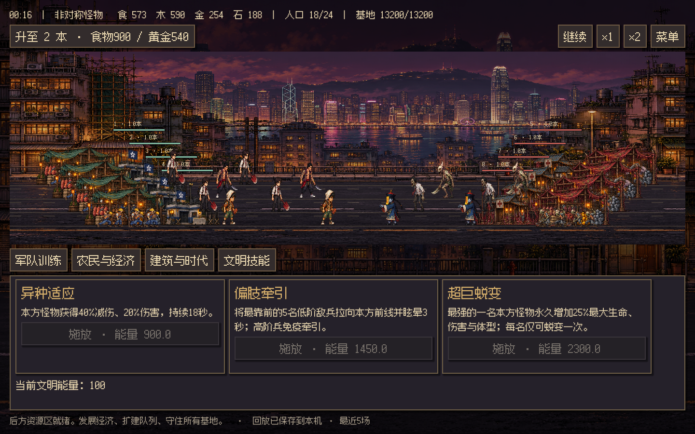

# 香港大战僵尸2：生死存亡 · Godot 像素重制

独立 Godot 4.7.2 项目，支持 Web 和 Windows x64。原项目和仓库不受影响。



## 运行

- Windows：从 Releases 下载 Windows ZIP，解压整个目录，运行 `HKVSZombie.exe`。规则运行组件已随包附带，不需要安装 Node 或 Godot。
- Web：下载 Web ZIP，解压并通过 HTTP 服务或 GameHub 托管 `index.html`。本项目使用 Godot 的单线程 Web 模板，并在导出后关闭仅针对线程版的安全上下文检查，同时把引擎资源固定到当前版本目录，因此兼容当前 GameHub HTTP 入口；不要直接双击 HTML。导出脚本还会检测 `AudioWorklet.addModule`、`AudioWorkletNode`、WebGL 和本地存储能力：不满足安全上下文的音频工作线程会自动降级到 Godot 的兼容音频路径，不会再触发 `Cannot read properties of undefined (reading 'addModule')`。开发预览执行 `npm run serve`，打开 `http://127.0.0.1:8074`。
- 开发：Godot 4.7.2 导入本目录 `project.godot`，按 F6/F5 运行。需要 Node 22+ 在 PATH 中，也可以设置 `HKVZ_NODE` 为 Node 可执行文件的绝对路径。

## 玩法与内容

12 文明、84 兵种、6 战争巨兽；双方可选、1v1 / 2v2 / 3v3 / 4v4、人机与真人联机、排位与战绩。四资源、农民分配、后方建筑与拆除、基地修复、升本进度、并行训练队列、文明技能、双 P 巨兽 GM 和最近五场录像全部保留。

每座兵营提供一条士兵队列，每座城镇中心提供一条农民队列。队列可自动路由或指定建筑，点击排队订单可取消并退还资源。录像支持暂停、0.5–16 倍速（界面提供 1/2/4/8/16）、视角切换、进度跳转、导入导出，复盘不结算战绩。

快捷键：`1–7` 训练士兵、`W` 训练农民、`U` 升本、`B` 建筑栏、`Space` 暂停本地局、快速按两次 `P` 打开 GM 巨兽选择、`Esc` 菜单。GM 局不计排位，联机 GM 仅房主可用。

## 如何保证规则不变

规则基线是 [HKVSZombie2 的 ff53022](https://github.com/fukeryester/HKVSZombie2/tree/ff53022)。`runtime/core/` 的 12 个规则模块与 `runtime/vendor/` 的 3 个平台 SDK 保留原始字节；校验清单见 `docs/upstream-hashes.json`。不重新平衡数值，也不把旧网页版 UI 嵌进游戏。

Godot/GDScript 原生负责所有场景绘制、图集动画、界面、输入与音效。**规则仍运行原版 JavaScript，并没有翻译为 GDScript**：Web 通过 JavaScriptBridge 调用；Windows 通过仅监听回环地址的 IPC 调用随包 Node。两端以相同 30 Hz 固定步长运行，渲染不修改战斗状态。这一结构用于严格满足规则、配置和结果保持一致的要求。

回放沿用原来的输入日志和每 900 逻辑帧的内存检查点，不是每秒保存完整状态的新方案。浏览器存 IndexedDB；Windows 存 Godot 用户数据目录下的 `rules/replays.json`，各保留五场，可导出 JSON 跨端播放。没有新增后端接口。

## 联机与账号

保留现有 GameHub API、房间协议、战绩和排行榜 SDK。网页在 GameHub 同源环境使用登录会话；Windows 在“账号”输入本人令牌，令牌仅保留在进程内，退出即清除。桌面默认游戏 ID 为原项目 `4405e915c069c808`。独立静态预览可玩本地人机与回放，但不提供 GameHub 登录服务。

本次不覆盖已上线的旧游戏，也不修改服务端。联机验证使用真实客户端 SDK 和隔离测试中继；生产账号、排行榜写入未在本次验证中执行。

## 美术与声音

新绘制 12 套文明角色动画图集，84 个兵种使用 12 个动作槽：四帧行走、两帧蓄力、两帧出手、两帧收招、两帧死亡。死亡残留 2.4 秒并淡出；步态依移动距离推进。农民与巨兽另有动作图集。来源与完整提示见 `docs/motion-art.json`；资源保存在 `assets/sprites`。战场采用确定性的随机显示纵深和透视缩放，底部紧凑操作栏，在 1440×900 普通对局中战场高度约占 77%。

Godot 版技能冷却统一为原值的 65%（取整，至少 1 秒），在适配层应用。新录像带 `-cd65` 标记；旧录像播放时恢复原冷却，不修改保存的输入。其他规则源码保持原始字节。

生成工具为内置 ImageGen，提示和来源记录见 `docs/art-prompts.json`，裁切区域见 `assets/data/atlas-regions.json`。原始图集不因裁切修改。Fusion Pixel 字体遵循 SIL OFL，随包包含许可。街机配乐、攻击音、警报、技能音和反攻号角由 Godot PCM 合成。

## 构建与验证

```powershell
npm ci
$env:GODOT_BIN='C:\path\Godot_v4.7.2-stable_win64_console.exe'
node tools/fetch-templates.mjs
npm run build
npm test
npm run serve
# 保持预览服务运行，在另一个终端执行：
node tests/web.mjs
node tests/network.mjs
powershell -File tools/package.ps1
```

导出目录是 `dist/windows`、`dist/web`；发布压缩包在 `dist/release`。不提交运行时二进制、导出包、缓存或凭据。已有图集区域标注无需安装 Python；需要重新计算标注时安装 Pillow 后运行 `python tools/atlas_regions.py`。

当前验证：98 项规则与适配测试通过；Web/桌面同种子同输入结果一致；WebAssembly 原生 UI 操作、快速连续训练、4v4、GM、回放持久化及前后跳转通过；两个真人客户端与六个 AI 的 4v4 同步和双方录像一致；Windows 导出包实际启动并生成截图。详细范围见 `docs/verification.md`。
